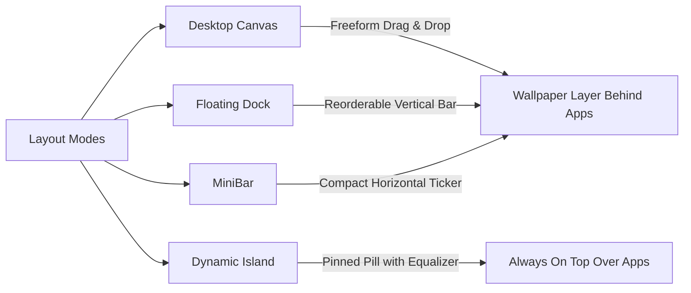

# Desktop-Overlay 🍏⚡

<p align="center">
  
</p>

<p align="center">
  <b>macOS Sonoma & Sequoia-inspired Minimalist Glass Desktop Widgets & Dynamic Island for Windows.</b><br>
  Rests natively on your desktop wallpaper behind open windows and apps — or pin the iPhone-style Dynamic Island above all apps. Fully modular, size-adjustable (S / M / L / V), freeform draggable, with real Windows hardware telemetry & live Spotify/browser media sync.
</p>

<p align="center">
  
  
  
  
  
  
  
  
</p>

---

## 🌟 Why Desktop-Overlay?

Most desktop widget engines for Windows force obnoxious "always-on-top" floating panels that obstruct your code editor, browser tabs, and gaming sessions. 

**Desktop-Overlay changes that completely:**
- **Lives on Your Desktop Wallpaper:** Renders seamlessly at the desktop wallpaper layer (`alwaysOnTop: false`). When you are working in Chrome, VS Code, or games, your widgets stay tucked away on your desktop.
- **Win+D / Show Desktop Immunity:** Windows normally hides all windows on `Win+D`. Desktop-Overlay intercepts and recovers gracefully, keeping your widgets permanently anchored to your desktop.
- **Selective Dynamic Island Pinning:** Love the iPhone / macOS Dynamic Island? Switch to Dynamic Island mode to pin an ultra-compact media pill **above all applications** with a live bouncing audio equalizer, volume slider, and track scrubber — while all transparent areas remain 100% click-through.
- **Zero Performance Drag & Single-Instance Lock:** Built with sub-100ms launch guards. Double-clicking the launcher when already running exits immediately without spawning duplicate processes or spiking CPU/RAM.

---

## 💎 Design Philosophy: macOS Minimalist Glass

- **Frosted Acrylic Glass:** Crafted using `.macos-glass` with `backdrop-filter: blur(28px) saturate(180%)`, deep soft shadows, and subtle `rgba(255, 255, 255, 0.09)` hairline borders. No obnoxious neon lasers or distracting cyberpunk gradients.
- **Apple Squircles:** `rounded-[24px]` continuous corner curves adhering strictly to Apple Human Interface Guidelines.
- **Progressive Disclosure:** Widgets reveal minimal glanceable metrics when small, and progressively disclose deep diagnostics as they scale up.

### Four Form Factors (S / M / L / V)

| Size | Dimensions | Visual Aspect | Purpose |
|:---:|:---:|:---:|:---|
| **Small (S)** | `164px × 164px` | Square | Glanceable status: circular radial progress rings, key metrics, and instant icons. |
| **Medium (M)** | `344px × 164px` | Landscape | Balanced telemetry: dual-axis metrics, live 30-sample SVG sparklines, and temps. |
| **Large (L)** | `344px × 344px` | Quad Square | Cockpit view: per-core micro-heatbars, process consumer lists, and multi-drive volumes. |
| **Vertical (V)** | `164px × 344px` | Portrait | Slim vertical column: ideal for side docks, vertical taskbars, and dual-monitor sidebars. |

---

## 🏝️ Pinned Dynamic Island Media Player

Desktop-Overlay features an authentic Apple-style **Dynamic Island** media pill:
- **Collapsed Pill:** Frosted obsidian pill (`bg-black/85 backdrop-blur-2xl`) with live album art, scrolling track/artist marquee, **live 4-bar bouncing audio equalizer waveform**, and quick play/pause.
- **Expanded Card (Click or Hover):** Smooth spring-physics expansion into an interactive 390px card:
  - High-res album artwork and app source badge (*Spotify, Brave, Chrome, Apple Music, Edge, etc.*).
  - Timeline progress scrubber with formatted timestamps (`01:23 / 03:45`).
  - Full playback controls (*Previous, Play/Pause, Next*).
  - Hardware volume slider with 1-click mute toggle.
  - Quick mode switch tabs (*Desktop Canvas, Side Dock, MiniBar*).
- **Persistent Overlay (`alwaysOnTop: true, 'floating'`):** Stays pinned over full-screen apps and browsers while keeping all transparent regions click-through to apps underneath.

---

## 🧩 14 Modular Widgets

| # | Widget | Key Features | Live Telemetry Source |
|:---:|:---|:---|:---|
| 1 | **⚡ Processor (CPU)** | Aggregate load %, 30s sparkline, clock GHz, package temp, per-core bars | `systeminformation` / WMI |
| 2 | **🎮 Graphics (GPU)** | 3D engine load %, VRAM allocation, GPU model name, temperature | Windows Direct3D / WMI |
| 3 | **🧠 Memory (RAM)** | Physical DDR usage %, used/total GB, pagefile swap, top RAM apps | Windows OS Memory Manager |
| 4 | **💾 Storage Drives** | Volume usage (`C:`, `D:`), free space GB, stacked progress bars | Windows Logical Disk Management |
| 5 | **🌐 Network Radar** | Inbound/outbound throughput (Mbps), live direction arrows, latency | Active Network Adapter |
| 6 | **🔋 Power & Battery** | Battery level %, AC charging bolt, battery condition, voltage | Win32 Battery API |
| 7 | **🎵 Now Playing** | Real-time track, artist, album art, progress scrubber, volume | **Windows GSMTC API** |
| 8 | **🔥 Top Processes** | Active process count, top 3/5 CPU/RAM consumers with 1-click kill | Windows Process Manager |
| 9 | **⏱️ Local Clock** | Apple typography local time, date, and 12/24hr format | Local System Clock |
| 10 | **🌍 World Clock** | Global financial time centers (UTC, Tokyo, London, New York) | System Uptime & Timezones |
| 11 | **🌤️ Weather** | Current temperature, condition ("Partly Cloudy"), high/low, humidity | Live Open-Meteo API |
| 12 | **📝 Quick Notes** | Desktop sticky notes, instant typing, character counter, local auto-save | `localStorage` |
| 13 | **⚡ Quick Actions** | 1-click Mute, Lock Workstation, Open Task Manager, Sleep PC | Windows Shell / PowerShell |
| 14 | **🤖 AI Quotas** | Real-time usage and burst quota monitors for Antigravity & Claude Code | AI Telemetry Providers |

---

## 🎯 Multiple Layout Modes

Switch seamlessly between layout modes directly from the Floating HUD or Dynamic Island:



1. **Desktop Canvas (`canvas`):** Freeform drag-and-drop. Place any widget anywhere on your screen. Coordinates are clamped within monitor bounds and persisted to `localStorage`.
2. **Floating Side Dock (`sidebar`):** macOS-style frosted side dock. Drag to reorder widgets, change sizes, or toggle between left/right screen anchors.
3. **MiniBar (`minibar`):** Ultra-minimal horizontal ticker for dual-monitor setups and ultrawides.
4. **Dynamic Island (`hud`):** Floats at top center above all application windows for persistent media control.

---

## 🚀 Quick Start (Under 60 Seconds)

### 1. Prerequisites
- **Windows 10 or 11** (64-bit)
- **Node.js** v20+ or v22+ ([Download Node.js](https://nodejs.org/))
- **npm** v10+ (included with Node.js)

### 2. Clone & Install
Open your terminal (PowerShell or Command Prompt) and run:
```powershell
git clone https://github.com/Aar-Kay23/Desktop-Overlay.git
cd Desktop-Overlay
npm install
```

### 3. Launch with 1-Click
Double-click **`start-desktop-overlay.bat`** or run:
```cmd
start-desktop-overlay.bat
```
> [!TIP]
> The launcher will automatically compile production assets on the first run, launch Electron detached into the background, and close the terminal window instantly so no stray black console stays open.

### 4. Stop Overlay Cleanly
Whenever you want to completely exit Desktop-Overlay:
Double-click **`stop-desktop-overlay.bat`** or run:
```cmd
stop-desktop-overlay.bat
```
*(You can also right-click the green Desktop Widgets icon in your Windows System Tray and click **Quit**).*

---

## ⌨️ Shortcuts & Controls

| Shortcut / Action | What It Does |
|:---|:---|
| **`Ctrl + Shift + D`** | Global hotkey: Instant Show/Hide toggle for all desktop widgets from anywhere in Windows. |
| **System Tray Click** | Left-click the taskbar notification tray icon to toggle visibility. |
| **System Tray Right-Click** | Open context menu to reload, quit, or toggle "Float Above All Windows". |
| **Drag Widget Header** | Click and drag any widget by its top title bar to move it freely across your desktop. |
| **Widget S / M / L / V Buttons** | Instantly switch widget size and aspect ratio with smooth layout transitions. |
| **+ Add Widget** | Open the widget gallery modal to toggle individual widgets on or off. |
| **Dynamic Island Pill** | Click or hover the top-center island to expand media controls and layout tabs. |

---

## 📂 Project Structure

```
Desktop-Overlay/
├── electron/
│   ├── main.cjs             # Electron main process (DWM layering, tray, IPC, Win+D protection)
│   ├── preload.cjs          # Context-isolated secure IPC bridge
│   ├── telemetry.cjs        # Live Windows hardware telemetry (CPU, RAM, GPU, Disks, Battery)
│   └── media.cjs            # Windows GSMTC WinRT daemon for real Spotify/browser Now Playing sync
├── src/
│   ├── components/
│   │   ├── layout/
│   │   │   ├── DesktopCanvas.tsx   # Freeform drag & drop canvas with boundary clamping
│   │   │   ├── FloatingHUD.tsx     # Dynamic Island with live equalizer & mode switcher
│   │   │   ├── GlassDock.tsx       # Reorderable macOS frosted side dock
│   │   │   ├── MiniBar.tsx         # Compact horizontal telemetry bar
│   │   │   └── WidgetGalleryModal.tsx # Add/Remove widget catalog
│   │   └── widgets/
│   │       ├── CpuWidget.tsx
│   │       ├── GpuWidget.tsx
│   │       ├── RamWidget.tsx
│   │       ├── StorageWidget.tsx
│   │       ├── NetworkWidget.tsx
│   │       ├── BatteryWidget.tsx
│   │       ├── MediaWidget.tsx
│   │       ├── ProcessWidget.tsx
│   │       ├── ClockWidget.tsx
│   │       ├── WorldClockWidget.tsx
│   │       ├── WeatherWidget.tsx
│   │       ├── NotesWidget.tsx
│   │       ├── QuickActionsWidget.tsx
│   │       └── QuotaWidget.tsx
│   ├── context/
│   │   └── TelemetryContext.tsx    # Global React state for telemetry, layout modes, & widgets
│   ├── types/                      # TypeScript definitions (telemetry, electron, widgets)
│   └── test/                       # Vitest unit test suites (20/20 passing)
├── start-desktop-overlay.bat       # Sub-100ms background launcher with duplicate prevention
├── stop-desktop-overlay.bat        # 1-click clean termination script
├── vite.config.ts                  # Vite + React configuration
└── package.json
```

---

## 🧪 Testing & Verification

Every component, formatter, data flow, and telemetry mutation is covered by automated unit tests using **Vitest** and **React Testing Library**:

```bash
# Run all unit tests
npm test

# Run tests with interactive watch mode
npx vitest

# Check TypeScript types & compile bundle
npm run build
```

```text
 ✓ src/test/components.test.tsx (4 tests)
 ✓ src/test/TelemetryContext.test.tsx (1 test)
 ✓ src/test/widgets.test.tsx (8 tests)
 ✓ src/test/mockData.test.ts (2 tests)
 ✓ src/test/formatters.test.ts (5 tests)

 Test Files  5 passed (5)
      Tests  20 passed (20)
```

---

## ❓ Frequently Asked Questions (FAQ)

<details>
<summary><b>Does Desktop-Overlay slow down my games or heavy apps?</b></summary>
<p>
No. When you are gaming or working inside full-screen apps, Windows Desktop Window Manager (DWM) naturally occludes background windows. Additionally, the telemetry daemon uses low-overhead asynchronous polling (1500ms intervals) consuming less than ~1% CPU.
</p>
</details>

<details>
<summary><b>What happens if I double-click <code>start-desktop-overlay.bat</code> multiple times?</b></summary>
<p>
Nothing breaks! The launcher includes a sub-100ms pre-flight process query. If an instance is already running, it exits immediately without launching redundant Node/Chromium processes. Electron's OS-level single instance lock automatically unhides your existing session.
</p>
</details>

<details>
<summary><b>Why can I click icons and windows through the overlay?</b></summary>
<p>
Desktop-Overlay utilizes Electron's <code>win.setIgnoreMouseEvents(true, { forward: true })</code>. Transparent regions pass all clicks directly through to your desktop icons, taskbar, and background apps. Hovering over a widget or the Dynamic Island activates interactive mode seamlessly.
</p>
</details>

<details>
<summary><b>Can I make all widgets stay above all windows instead of on the desktop?</b></summary>
<p>
Yes! Right-click the system tray icon and check <b>"Float Above All Windows"</b>, or press <code>Ctrl+Shift+D</code> to toggle visibility.
</p>
</details>

---

## 🤝 Contributing

Contributions, feature suggestions, and bug reports are welcome!
1. Fork the Project.
2. Create your Feature Branch (`git checkout -b feature/AmazingWidget`).
3. Verify tests and build pass (`npm test && npm run build`).
4. Commit your Changes (`git commit -m 'feat: add AmazingWidget'`).
5. Push to the Branch (`git push origin feature/AmazingWidget`).
6. Open a Pull Request.

---

## 📄 License

Distributed under the **MIT License**. See `LICENSE` for more information.

Developed with ❤️ by [Aar-Kay23](https://github.com/Aar-Kay23).
